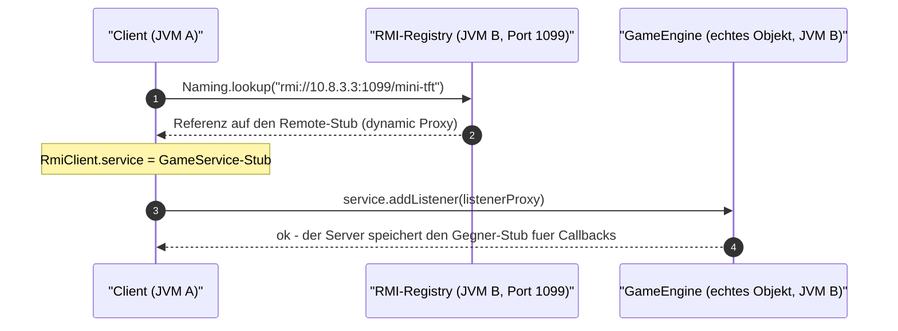
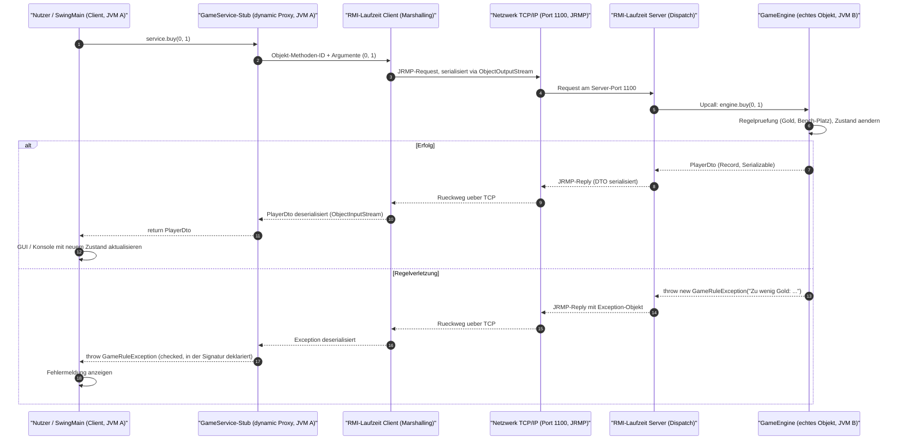
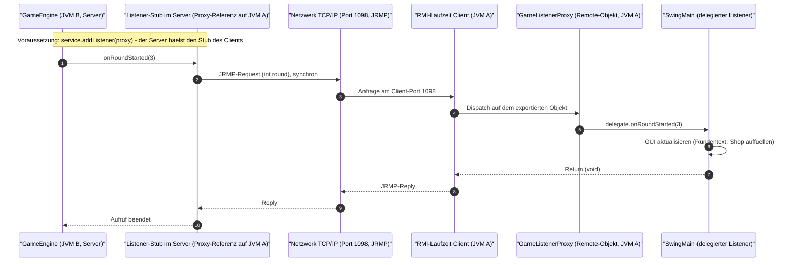

<!-- AI-GENERATED-START: Aufgabe 5 - Sequenzdiagramme fuer entfernte Aufrufe (C->S Befehl und S->C Callback) - 2026-11-02 15:20 CET -->
# Sequenzdiagramme (Aufgabe 5)

Ablauf **eines einzelnen entfernten Aufrufs** – einmal in jede Richtung unseres
bidirektionalen Contracts.

- **Diagramm 1:** Client → Server, `GameService.buy(...)` (Befehl, Rückgabe DTO)
- **Diagramm 2:** Server → Client, `GameListener.onRoundStarted(...)` (Push-Event)

Beide zeigen: Stub-Aufruf → Marshalling → Netzwerk → Dispatch auf dem echten
Objekt → Rückweg (bzw. Exception) → Ergebnis im Aufrufer.

---

## 0. Verbindungsaufbau (Voraussetzung für beide Diagramme)



---

## 1. Client → Server: `buy(int playerId, int slot)`



**Zu beachten:**
- Der Aufruf ist **synchron**: der Client blockiert bis zur Rückkehr (Aufgabe 6
  misst genau diese Dauer).
- `GameRuleException` wird **mit übertragen** (Signatur
  `throws GameRuleException, RemoteException`) → Aufgabe 7.
- Marshalling hier = `java.io.Serializable` der DTO-Records; das JSON-Format aus
  `JsonMapper` liegt als String **im** Argument/Rückgabewert
  (`executeJson`, `getStateJson`).

---

## 2. Server → Client: `onRoundStarted(int round)` (Push-Callback)



**Zu beachten:**
- Der Server **ruft beim Client auf** – nur möglich, weil der Client sein
  `GameListenerProxy`-Objekt exportiert hat (`UnicastRemoteObject.exportObject`,
  fester Port 1098) und den Stub bei `addListener` mitgeliefert hat.
- Erreicht der Server Port 1098 nicht (Firewall/NAT), erzeugt RMI pro Callback
  eine `ConnectException` mit Timeout → sichtbar als
  `Listener-Callback fehlgeschlagen: ...` auf dem Server.

---

## Skizze zum Abzeichnen (reicht laut Aufgabe als „saubere Skizze")

```
 Client (JVM A)                                          Server (JVM B)
+---------------------+                              +----------------------+
| SwingMain            |                              | GameEngine           |
|        |            |                              |   (echtes Objekt)    |
|        v            |                              |        ^             |
| GameService-Stub ---+-- Marshalling (DTO/long) ----+--> RMI-Dispatch      |
|  (dynamic Proxy)    |        Netz / TCP 1100       |        |             |
|                     |<-- Unmarshalling (Rueckgabe  | Regelpruefung+Logik  |
|        v            |        oder Exception)       |        v             |
| GUI aktualisiert    |                              | PlayerDto / Fehler   |
+---------------------+                              +----------------------+

 Rueckrichtung (Push):
 GameEngine -- onRoundStarted / onCombatFrames --> Listener-Stub (Serverseite)
            -- Netz / TCP 1098 --> GameListenerProxy (Client) --> GUI
```

## Stubs: konkret in unserem Code

| Remote-Interface | Echte Implementierung | Stub-Werter auf der Gegenseite | Wo entsteht der Stub |
|---|---|---|---|
| `GameService` | `GameEngine` (Server) | dynamic Proxy, gehalten von `RmiClient.service` | `Naming.lookup(...)` |
| `GameListener` | `RmiClient.GameListenerProxy` (Client) | dynamic Proxy, gehalten in `GameEngine.listeners` | `UnicastRemoteObject.exportObject(...)` + `addListener(...)` |
| – DTOs (`GameStateDto`, `PlayerDto`, `UnitDto`, `CombatFrameDto`, `CombatResultDto`) | – | **kein Stub**, nur `Serializable` | – |

**Hinweis für die mündliche Prüfung:** Skeleton-Klassen gibt es seit Java 5
nicht mehr – die „Stubs" sind dynamische Proxies (`java.lang.reflect.Proxy`),
die RMI beim `lookup` bzw. beim Export erzeugt; die Methode wird über die
Objekt-ID + Methodensignatur identifiziert und per Refection auf dem Server
ausgeführt (Dispatch), nicht über generierten Code.
<!-- AI-GENERATED-END -->
